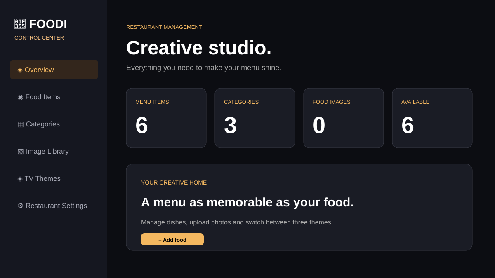
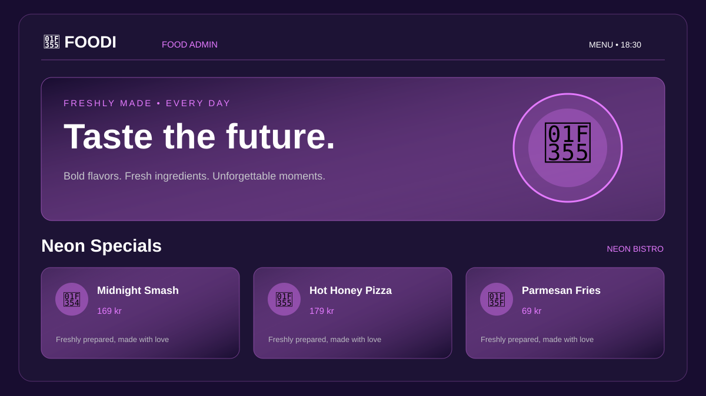
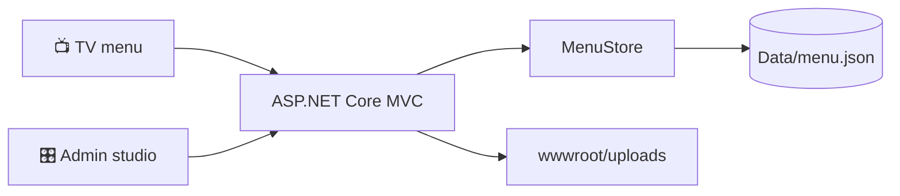

# 🍕 FOODI Food Admin — Digital Menu Studio

<p align="center"></p>

<p align="center"><strong>🍕 Make every menu look delicious.</strong><br/>A cinematic restaurant TV menu and dark-mode management studio.</p>

The official **FOODI Food Admin** Italian pizza chef banner is sourced from [`italiensk-pizzakock-med-foodi-banner-1.png`](italiensk-pizzakock-med-foodi-banner-1.png) and reused as **one local PNG** (`wwwroot/images/foodi-logo.png`) in the TV header, home hero, admin sidebar, dashboard, footer and favicon. Any future sign-in or boards pages should reuse the same local asset.

**A cinematic dark-mode TV food menu and admin studio, built with ASP.NET Core MVC, C# and JSON files instead of SQL.**

[](https://dotnet.microsoft.com/)


> **Screenshot note:** The four images below are illustrated UI previews based on the application design, not captures of a running .NET application. For real screenshots, run the app and capture `/Tv` and `/Admin` in a browser.

## 🖼️ Screenshots & visual previews

### 🎛️ Admin control center



The admin dashboard centralizes **food CRUD**, **category CRUD**, **image uploads**, **theme selection**, and **restaurant settings**.

### 📺 TV theme previews

| ✨ Noir & Gold | 🔥 Ember & Flame | 💜 Neon Bistro |
|:---:|:---:|:---:|
| [](docs/screenshots/theme-noir.svg) | [](docs/screenshots/theme-ember.svg) | [](docs/screenshots/theme-neon.svg) |
| Elegant champagne-gold | Charcoal and fire-orange | Glossy violet and pink |

All three themes share the same food and image data. Preview without saving, or select one in **Admin → TV Themes → Save selected theme**.

## ✨ Features

| Area | Capabilities |
| --- | --- |
| 📺 **TV showcase** | Premium fullscreen digital menu, large type, clock, photo-led featured area, automatic category rotation on `/Tv` |
| 🍔 **Food CRUD** | Create, edit, delete, sort, price, badge, availability, featured flag and allergens |
| 🗂️ **Category CRUD** | Create, edit, delete, sort and hide categories |
| 📸 **Image CRUD** | Upload JPEG/PNG/WebP up to 8 MB, edit image descriptions, delete and assign images to foods |
| 🎨 **Brand studio** | Restaurant name, hero headline, description, accent color, currency, price visibility; shared FOODI logo PNG |
| 🖥️ **Theme picker** | Three distinct selectable themes with mini-previews, full TV preview and persistent active selection |
| 💾 **Data** | Auto-created `Data/menu.json` using locked atomic writes; local uploaded images in `wwwroot/uploads` |
| 🔒 **Admin** | Cookie-based admin session, anti-forgery tokens for forms; bootstrap URL for initial access |

## 🎨 Three premium TV menu designs

### 1. ✦ Noir & Gold

Black and champagne-gold. Editorial serif headings, restrained borders, elegant food presentations and subtle luxury lighting.

### 2. 🔥 Ember & Flame

Charcoal and orange. Glowing amber details, bold uppercase typography, smoky backgrounds and fire-grilled energy.

### 3. 💜 Neon Bistro

Electric purple and pink. Glossy futuristic cards, neon highlights, gradients and luminous accents.

Visit **Admin → TV Themes** to preview, select and **save** your favorite. All three styles share the same foods, categories, prices and photo library.

| Preview | URL |
| --- | --- |
| Noir & Gold | `/Tv?theme=noir` |
| Ember & Flame | `/Tv?theme=ember` |
| Neon Bistro | `/Tv?theme=neon` |
| Saved active selection | `/Tv` |

Preview links do not change the saved selection. Choosing a theme and clicking **Save selected theme** writes the value to `Data/menu.json`.

## 🧭 Pages and routes

| Page | URL | Purpose |
| --- | --- | --- |
| 🏠 Home | `/` | Restaurant menu showcase |
| 📺 TV display | `/Tv` | Auto-rotating category wallboard |
| 🔐 Admin bootstrap | `/Admin?superadmin=walter` | Development-only admin entry |
| 🎨 Theme picker | `/Admin#themes` | Select and save a TV theme after login |
| 🍔 Food management | `/Admin#foods` | Create, update and delete dishes |
| 🗂️ Categories | `/Admin#categories` | Category visibility and sorting |
| 📸 Images | `/Admin#images` | Upload, describe, assign and delete photos |
| ⚙️ Settings | `/Admin#settings` | Restaurant name, pricing and display options |

## 🚀 Run locally

Requires the [.NET 8 SDK](https://dotnet.microsoft.com/download/dotnet/8.0).

```bash
git clone https://github.com/1x4x/walter.nu-foodadmin.git
cd walter.nu-foodadmin
dotnet restore
dotnet run
```

Open the localhost address printed in your terminal and use:

- **Digital menu:** `/` or `/Tv`
- **Administrator bootstrap:** `/Admin?superadmin=walter`
- **Theme selection:** `/Admin#themes` after signing in

## 🧑‍🍳 Manage your restaurant menu

1. Open the admin URL.
2. Create categories in **Categories**.
3. Upload food photography in **Image Library**. Add or edit descriptive text, or delete old photos.
4. Add dishes in **Food Items** with prices, categories, badges, allergens and photo assignments.
5. Open **TV Themes** and try all three design previews; save the active design.
6. Personalize the restaurant using **Restaurant Settings**.
7. Open `/Tv` on a restaurant display and select **Fullscreen**. TV mode cycles through categories using the configured rotation interval.

## 🧩 How the app works



The `MenuStore` serializes updates to a single JSON file, and uploaded food photos are stored on the server disk. New installations start with demo categories and dishes.

## 📁 Project structure

```text
walter.nu-foodadmin/
├── Controllers/
│   ├── AdminController.cs
│   └── HomeController.cs
├── Models/MenuModels.cs
├── Services/MenuStore.cs
├── Views/
│   ├── Admin/Index.cshtml
│   ├── Home/Index.cshtml
│   └── Shared/_Layout.cshtml
├── wwwroot/
│   ├── images/foodi-logo.png   # exact Italian pizza chef banner, shared branding + favicon
│   ├── css/site.css
│   ├── js/site.js
│   └── uploads/               # created on first upload
├── docs/screenshots/          # illustrated previews
├── Data/menu.json              # created automatically, ignored by git
├── Program.cs
└── RestaurantVision.csproj
```

## 🔐 Security considerations

The requested `?superadmin=walter` URL is **a development convenience, not robust production authentication**. The key is in the URL and may be recorded by logs or browser history. For deployment, replace it with genuine login/identity controls, HTTPS and rate limiting, and restrict admin access to trusted users/networks. At minimum override the secret using `Admin__BootstrapKey` as an environment variable; **never expose the default key on a public server**.

All modifying admin forms require an authenticated admin cookie and anti-forgery token. Uploaded files have an 8 MB limit and basic format/signature validation; consider image re-encoding and malware scanning for public deployment. Uploaded files and JSON are intentionally excluded from source control.

## 📺 Display and deployment notes

- Display works best on a widescreen 16:9 TV with browser fullscreen (F11 or the app's **Fullscreen** action).
- Sample dishes are seeded on first launch. Upload your own photos to replace stylish placeholders.
- Showcase background images and Google Fonts are currently fetched from external hosts; replace with licensed local assets for offline/kiosk installation.
- The menu JSON is suitable for a single server process. Multi-server deployment requires more robust storage and coordination.
- Code is supplied for local development; verify builds and test in your target environment before public deployment.

## 🛠️ Troubleshooting

| Problem | What to check |
| --- | --- |
| Blank menu | Ensure at least one visible category contains an available food item. |
| Photo missing | Upload a supported image in **Image Library** and assign it to a dish. |
| Theme didn't change | Click **Save selected theme**, then reload `/Tv`. |
| Admin access fails | The bootstrap URL is for first access; check `Admin__BootstrapKey` and cookies. |
| Data resets unexpectedly | Preserve `Data/menu.json` when deploying and ensure the app can write to `Data/`. |

## 📷 Capturing real screenshots

Run the app, open `/Admin` and `/Tv?theme=noir`, `/Tv?theme=ember`, `/Tv?theme=neon`, and save browser screenshots. Replace the illustrated SVG previews in `docs/screenshots/` with real screenshots when a running deployment is available.

## 🍕 Chrilles Restaurang menu import

The app now starts with **Chrilles Restaurang** and a curated JSON seed of **106 dishes and sides across 15 categories** in `Seed/chrilles-menu.json`. The seed is based on the restaurant's public online menu at https://www.chrillesrestaurang.se/ (checked 2026-11-23). The site's pizza numbering skips 12–15, repeated Fish and Chips entries were deduplicated, and the children's pizza discount is represented as a zero-price note requiring review rather than a negative menu price. Prices are copied as shown and should be verified before public use.

**Existing installations:** Your `Data/menu.json` is never silently overwritten. In **Admin → Overview**, choose **Import missing Chrilles menu items** to add missing seeded IDs without overwriting existing edits, categories or images. The restaurant name is set to Chrilles Restaurang.

### 📸 Multiple images per dish

Each food item has an `ImageIds` gallery and a separate optional `ImageId` for the chosen TV image. Default is **no image**. Upload an image and optionally attach it to a food, or attach existing photos in **Image Library → Manage each food gallery**. Select the TV photo, remove photos from the gallery, or clear the selection. Removing a file from the global library also removes its gallery references.

### 🍽️ Bulk update real food

Each food item has an editable `IsRealFood` flag. Use **Admin → Food Items → Bulk update real food only** to update all qualifying items, optionally filtered by category. Supported actions: percentage price change, fixed price, badge and availability. Drinks, ice cream and sauces can be flagged as non-real-food and excluded. All 106 seeded items are individually editable, and sauces are excluded from bulk updates by default. Review the flag for new or ambiguous items.
